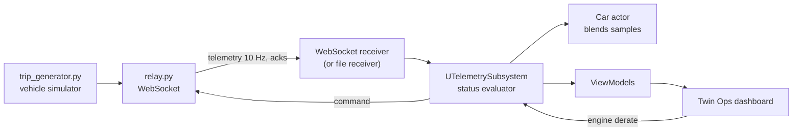

# Vehicle telemetry twin

A vehicle telemetry twin with a remote-operations dashboard: a car in Unreal Engine 5.7 (C++) driven by streamed telemetry, with
live status, a link that survives drops, and an engine derate command whose effect comes back through telemetry.

<!-- GIF: Warning → Critical, recorded after wrap-up item 2 (docs/DEMO_SCRIPT.md, "GIF for the README") -->

| Measured | |
|----------|---|
| Frame time, studio + dashboard | **5.0 ms** median, p99 8.0 ms (RTX 4060 Ti, 1080p, without the car) |
| Telemetry latency, relay → game thread | **2.9 ms** average, 0 of 1,431 messages dropped |
| Car | **1.4 M** triangles, **~460** draw calls per frame (RTX 3070 Ti Laptop) |
| Automated tests | **101** pass: 41 Unreal, 60 Python |

Method and machines: [PERFORMANCE.md](docs/PERFORMANCE.md).

## How to run

Needs UE 5.7, Visual Studio 2022 with C++, Python 3.10+.

1. **Generator** (optional; `Data/Trips/trip_sample.json` is committed): `python Tools/TripGenerator/trip_generator.py --seed 42 --out Data/Trips/trip_sample.json`
2. **Relay:** `pip install -r Tools/Relay/requirements.txt`, then `python Tools/Relay/relay.py --source live`
3. **Unreal:** open `CarDigitalTwins.uproject` (builds the C++ module), set Project Settings > Vehicle Telemetry > Telemetry Source
   to **WebSocket**, press Play in `L_TwinStudio`. Keys 1–4 switch views.

Without the relay, Telemetry Source **File** (the default) plays the sample trip. The car meshes aren't in this repository (see
[Credits](#credits)); without them the studio and the dashboard run, with no car.

---

## What this shows

**Unreal C++.** GameInstance subsystems; an `ITelemetryReceiver` interface with file and WebSocket implementations; a custom stencil
post-process outline for status; wheel centre, axle and the 43.5 cm tyre radius measured from the mesh at runtime; UMG with a
hand-built MVVM layer (field masks, one batched flush per frame, RAII subscriptions); in-editor automation tests.

**Real-time pipeline.** A versioned camelCase schema ([SPEC.md](docs/SPEC.md) §2); a WebSocket state machine Idle → Connecting →
Live → Stale → Disconnected with exponential backoff and jitter; latency and gap measurement; samples blended between 10 Hz updates;
a command path with acks, `appliedAtSeq` and a 2 s timeout.

## Decisions

- **Ack is not effect.** The relay's ack only says the command was accepted. The dashboard shows derate when the vehicle reports
  `EngineDerate` in telemetry, never from the command it sent (SPEC §2.5).
- **Worst-of status with hysteresis.** Each signal enters Warning or Critical at one threshold and clears at a lower one, so values
  near a limit don't flicker; the overall status is the worst signal (SPEC §3).
- **Parts found by tag, not by name.** Wheels, tyres and callout anchors are found by component tag, so a re-imported
  mesh only needs its tags.
- **No hand-written JSON parser.** Messages map onto `USTRUCT`s through `FJsonObjectConverter`.
- **$0 hosting.** Cloud GPU pricing was checked twice ([COSTS.md](docs/COSTS.md)): about $74 a month at 2 h a day. Pixel Streaming
  runs locally ([Tools/PixelStreaming](Tools/PixelStreaming/README.md)); the demo is a video.
- **Dated decisions and scope cuts** in [PROGRESS.md](docs/PROGRESS.md) and [LEARNING_LOG.md](docs/LEARNING_LOG.md); bugs in
  [BUGS.md](docs/BUGS.md).

## Tests

| Suite | IDs | Count |
|-------|-----|-------|
| Trip generator (pytest): schema, phases, incidents, byte-exact output per seed | P | 45 |
| Relay (pytest): envelope, rate, drops, pause, commands and acks, bad frames | R1–R11 | 15 |
| MVVM core (UE automation): masks, tolerances, batched flush, subscriptions | M1–M11 | 11 |
| File receiver (UE): loading, field mapping, rejection, playback timing, looping | U1–U9 | 9 |
| Twin actor (UE): wheel setup, spin, steer, status colour and outline, blending, callout anchors | V1–V10 | 10 |
| Status evaluator (UE): every SPEC §3 threshold both ways, hysteresis, worst-of | S1–S11 | 11 |

How to run each suite and what every test checks: [TESTS.md](docs/TESTS.md).

## Known issues

Not yet checked with the car (it is on one machine only): the `UViewModelSubsystem` tick in PIE, the camera blends between views, the
studio lighting, the `CarRoot` facing warning and a doubled outline at PIE start. [BUG-002](docs/BUGS.md): the status outline doesn't
show on `BP_VehicleTwin_Rebuilt` (open, parked).

## Follow-ons (not built)

An in-car HMI view on the same core; MQTT receiver; VSS signal mapping; a cloud deployment; a real-data clip; a fleet of cars. An
OpenUSD / Omniverse version is a separate project.

## Credits

**Vehicle model:** [2010 Jeep Wrangler Rubicon](https://grabcad.com/library/2010-jeep-wrangler-rubicon-1) by **Kostiantyn Abramov**,
from the GrabCAD Community Library. Used for non-commercial purposes under the GrabCAD Community terms, with credit to the author.

The CAD files and the Unreal meshes converted from them are **not included** in this repository. To run with the car, download the
model from the link above and follow the import steps in [ASSETS.md](docs/ASSETS.md).

This is a non-commercial portfolio project and is not affiliated with or endorsed by Jeep or Stellantis.
